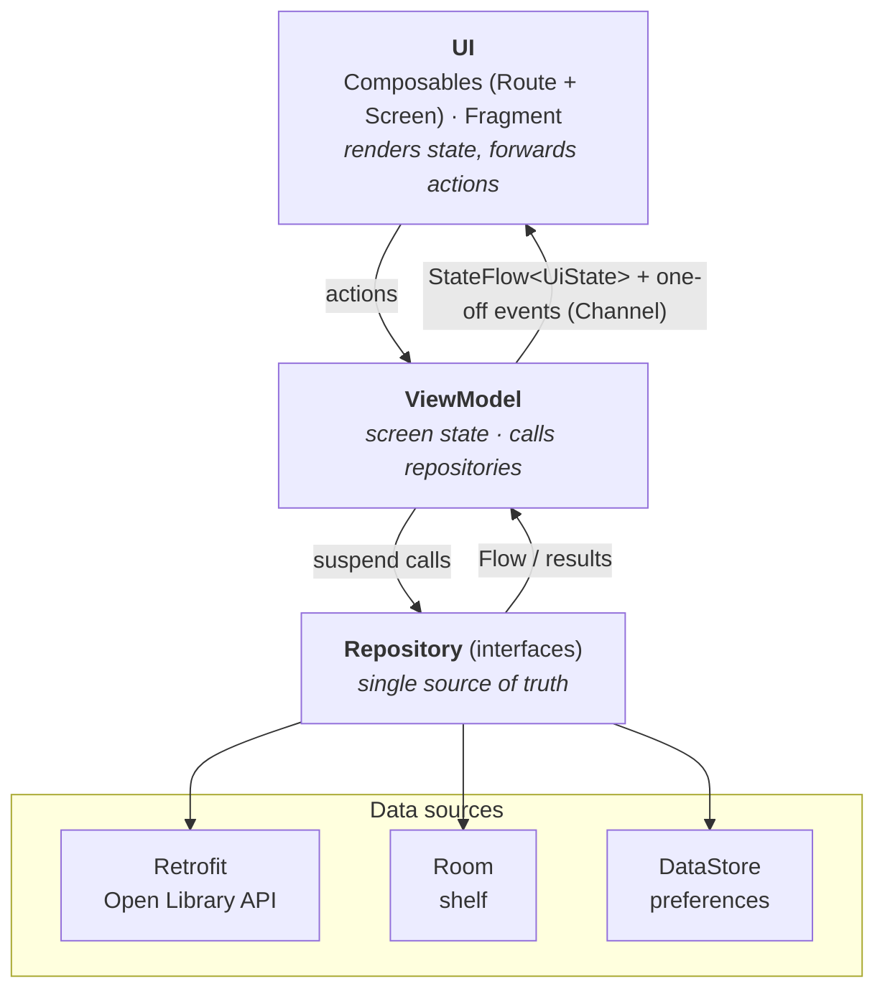
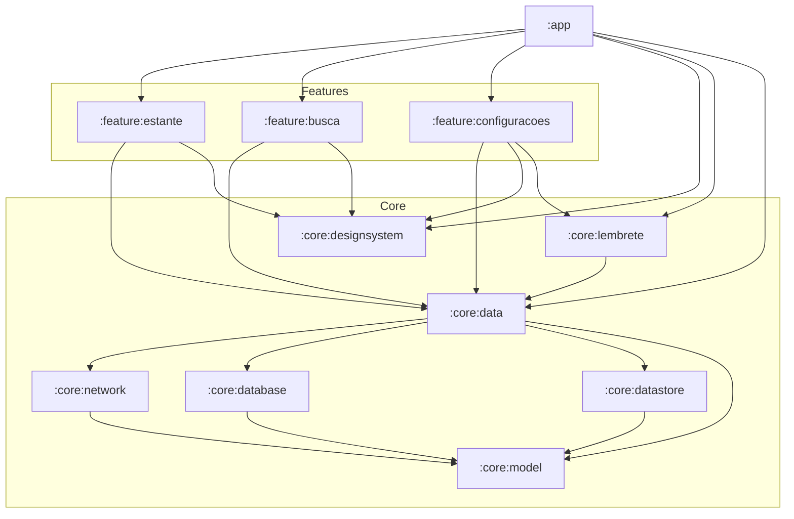

# Minha Estante

[](https://github.com/GuiLD10/minha-estante-android/actions/workflows/ci.yml)


**Minha Estante** ("My Shelf") is a personal reading shelf for Android. Search books on
[Open Library](https://openlibrary.org/), add them to your shelf and keep track of what you
want to read, are reading and have already read. The shelf works fully offline, and an
optional daily notification reminds you to keep reading.

This is a study and portfolio project: the goal is to practice, in a single small app, the
toolset expected from a modern Android developer: Kotlin, Jetpack Compose, MVVM,
Coroutines/Flow, Room, DataStore, Hilt, WorkManager, automated tests, a modular Gradle build
and CI.

> The UI is in Brazilian Portuguese. Code identifiers for the domain are in Portuguese too
> (`Livro` = book, `Estante` = shelf, `Busca` = search), while framework terms stay in English
> (`EstanteRepository`, `BuscaViewModel`, `LivroDao`).

## Screenshots

| Shelf | Search | Details | Settings |
|:---:|:---:|:---:|:---:|
|  |  |  |  |

## Features

- **Shelf** (home screen, Compose): lists saved books with title, authors, status and a
  progress bar, plus *All / Want to read / Reading / Read* filter chips. Works offline.
- **Search** (Compose): searches Open Library as you type (400 ms debounce). Results already
  on the shelf are marked, and network or server errors show a *Try again* action. The last
  search is restored when the screen opens again.
- **Details** (Compose): change the reading status, update the current page and remove the book
  (with confirmation). Status and page follow domain rules: reading the last page marks the
  book as *Read*, and starting a *Want to read* book moves it to *Reading*.
- **Settings** (XML + ViewBinding + Fragment): pick the theme (system / light / dark) and toggle
  the daily reading reminder, asking for the notification permission on Android 13+.
- **Daily reminder** (WorkManager): every day at 8 PM, if there are books being read, a
  notification suggests reading for 20 minutes. Tapping it opens the app.

## Tech stack

| Area | Technology |
|---|---|
| Language | Kotlin |
| UI | Jetpack Compose + Material 3; XML + ViewBinding on the Settings screen |
| Navigation | Navigation Compose with type-safe routes (`@Serializable`) |
| Architecture | MVVM, Repository pattern, unidirectional data flow, `UiState` as sealed interfaces |
| Async | Coroutines, Flow, StateFlow, Channel |
| Network | Retrofit + OkHttp + kotlinx.serialization |
| Local data | Room (shelf), DataStore Preferences (settings) |
| Dependency injection | Hilt (including `hilt-work` and `hilt-navigation-compose`) |
| Background work | WorkManager (`CoroutineWorker` + `@HiltWorker`) |
| Tests | JUnit 4, MockK, kotlinx-coroutines-test, Turbine, AndroidX Test, Room in-memory, Compose UI Test |
| Build | Gradle Kotlin DSL, version catalog, type-safe project accessors, KSP |
| CI | GitHub Actions |

## Architecture

The app follows the layered architecture recommended by the Android team. Data flows **up**
as streams (`Flow`), while user actions flow **down** as function calls.



- The UI never touches a repository, DAO or API directly.
- ViewModels depend on repository **interfaces**, never on implementations, so tests can swap
  in fakes.
- DTOs (network) and entities (database) are `internal` to their modules and are mapped to
  the plain Kotlin models of `:core:model`. They never reach the UI.

### Modules



| Module | Responsibility |
|---|---|
| `:app` | `MainActivity`, `Application` (Hilt + WorkManager setup), `NavHost`, notification channel |
| `:feature:estante` | Shelf and Details screens and their ViewModels |
| `:feature:busca` | Search screen and ViewModel |
| `:feature:configuracoes` | Settings `Activity` + `Fragment` (XML) and ViewModel |
| `:core:model` | Domain models and pure business rules (**pure Kotlin/JVM**, no Android) |
| `:core:designsystem` | Compose theme and shared resources |
| `:core:network` | Retrofit API, DTOs and DTO mappers |
| `:core:database` | Room database, entities, DAO and type converters |
| `:core:datastore` | DataStore preferences data source |
| `:core:data` | Repository interfaces, implementations and mappers |
| `:core:lembrete` | Reminder worker, scheduler and notification |
| `:core:testing` | Shared fakes and `MainDispatcherRule` (test-only) |

Rules: features never depend on each other, `core` modules never depend on features, and
`implementation` is preferred over `api`, so each module only sees what it needs.
All versions live in [`gradle/libs.versions.toml`](gradle/libs.versions.toml).

## Technical decisions

**Offline-first shelf.** Every shelf screen observes Room through `Flow`, and nothing there
depends on the network. When a book is added or updated, the database emits a new list and the
UI updates by itself, with no manual refresh and no "loading from server" state. The network is
only used by the search screen. Search results are intentionally not cached, to keep the scope
small.

**Room vs. DataStore.** The shelf is structured, queryable data: it is filtered by status,
looked up by id and sorted by date. That is a relational table, so it goes into Room. Settings
are a handful of independent key-value pairs (theme, reminder on/off, last search), which is
what DataStore Preferences is for. DataStore is asynchronous (Flow-based) and transactional,
unlike the old `SharedPreferences`.

**Business rules as pure functions.** Rules such as "reaching the last page marks the book as
*Read*" live in `:core:model` as extension functions (`comProgresso`, `comStatus`,
`progressoPercentual`). That module has no Android dependency, so the rules are tested in
milliseconds on the JVM, and repositories just read, apply the rule and write.

**Route + Screen composables.** Each screen is split in two. `XRoute` obtains the ViewModel and
collects state. `XScreen` is stateless and receives state and callbacks. Because of that, every
screen state has a `@Preview`, and UI tests render the screen directly from a hand-built
`UiState`, with no ViewModel, Hilt or database. Screens also never receive the
`NavController`, only callbacks such as `onLivroClick`, so they don't know about navigation.

**State vs. one-off events.** Screen state is a `StateFlow<UiState>`, where `UiState` is a sealed
interface, so each state is explicit and the `when` is exhaustive. Things that must happen only
once, like a Snackbar or "go back after deleting", are sent through a `Channel` exposed as
`Flow`, so they aren't replayed after a configuration change.

**Errors flow up to the ViewModel.** Repositories do not catch network errors. `IOException`
and `HttpException` reach the `BuscaViewModel`, which maps them to typed errors
(`ErroBusca.SemConexao`, `ErroBusca.Servidor(code)`). The screen translates each type into a
string resource. Only specific exceptions are caught, so coroutine cancellation is never
swallowed.

**Why XML on the Settings screen.** Most existing Android codebases still use Views, so the
Settings screen is deliberately built the classic way: an `AppCompatActivity` hosting a `Fragment`,
a `ConstraintLayout`, ViewBinding (with the `_binding` / `onDestroyView` pattern) and
`repeatOnLifecycle` to collect flows safely. It shows that Compose and Views can live in the
same app, and in debug builds it logs lifecycle callbacks to observe their order.

**Testable background work.** The decision made by `LembreteWorker` (notify or not, and with
which text) is extracted into a small function that receives the repositories, so it is covered
by plain unit tests. The worker only wires it to WorkManager and the notification. The
initial delay until 8 PM is also a pure function, tested across days and DST changes.

## Getting started

**Requirements:** Android Studio (latest stable) and JDK 17+. The Gradle daemon toolchain is
provisioned automatically. No API key is needed, since Open Library is a free public API.

```bash
git clone https://github.com/GuiLD10/minha-estante-android.git
cd minha-estante-android
./gradlew assembleDebug        # builds app/build/outputs/apk/debug/app-debug.apk
./gradlew installDebug         # installs on a connected device or emulator
```

Or open the project in Android Studio and run the `app` configuration.

To try the reminder without waiting until 8 PM, open **Settings** in a debug build, turn the
reminder on and tap **"Disparar lembrete agora (debug)"**. At least one book must be in the
*Reading* status.

## Testing

```bash
./gradlew testDebugUnitTest :core:model:test   # unit tests (JVM)
./gradlew connectedDebugAndroidTest            # instrumented tests (emulator or device required)
./gradlew lintDebug                            # static analysis
```

| Kind | What is covered |
|---|---|
| Unit: domain | Progress percentage, status and progress rules, search result → book, author formatting |
| Unit: data | Repositories with mocked API/DAO (MockK), mappers, Room type converters, DataStore |
| Unit: ViewModels | Shelf, Search (debounce, errors, "already on shelf", events), Details, Settings and theme, using fakes from `:core:testing` + Turbine |
| Unit: reminder | Notify / don't notify decision and the delay until 8 PM |
| Instrumented | `LivroDaoTest` (Room in-memory), `EstanteScreenTest` and `BuscaScreenTest` (Compose UI Test) |

Unit test names follow the pattern *"when X, then Y"* (in Portuguese, using backticks).
`MainDispatcherRule` replaces `Dispatchers.Main` so ViewModels can be tested on the JVM.

**CI:** [GitHub Actions](.github/workflows/ci.yml) runs unit tests and lint on every push and
pull request to `main`. If a test fails, the reports are uploaded as a build artifact.

## Acknowledgements

Book data is provided by the [Open Library API](https://openlibrary.org/developers/api).
